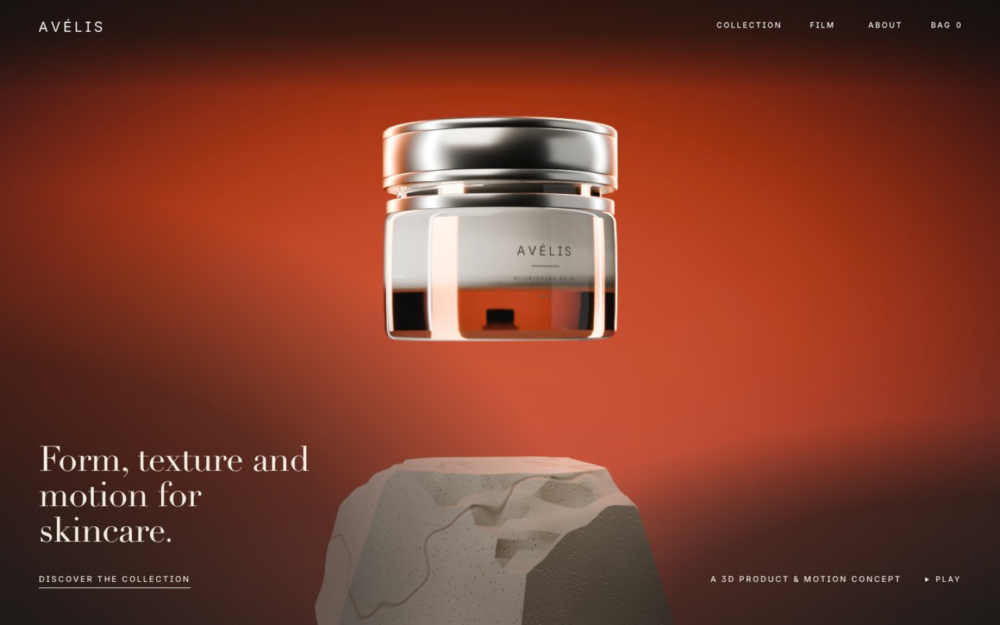
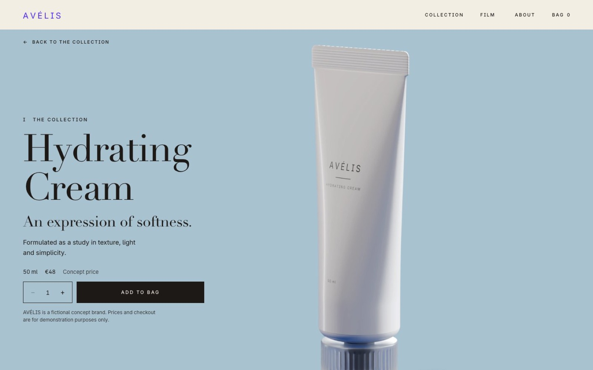
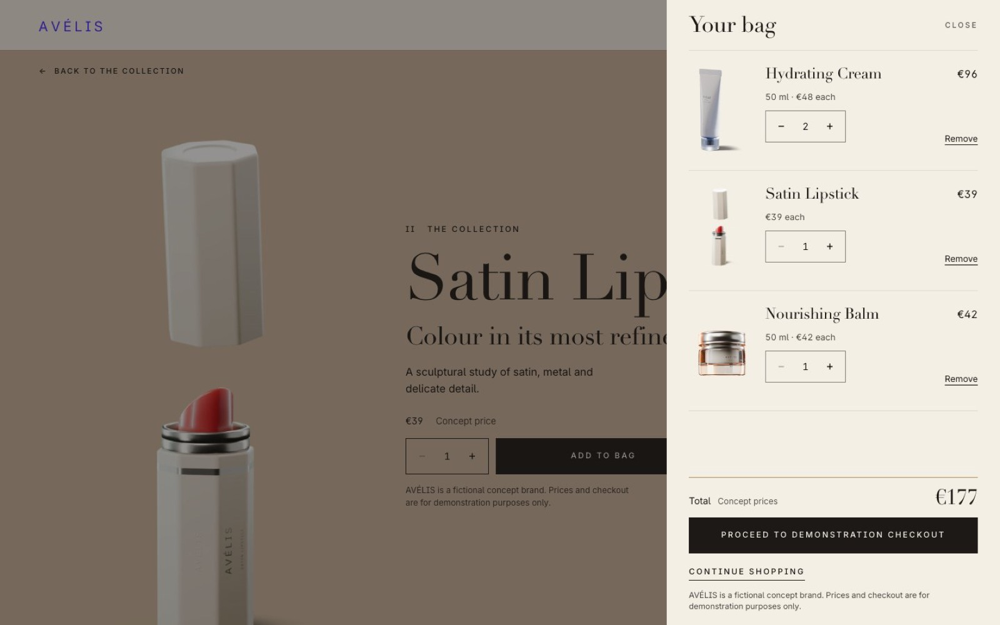
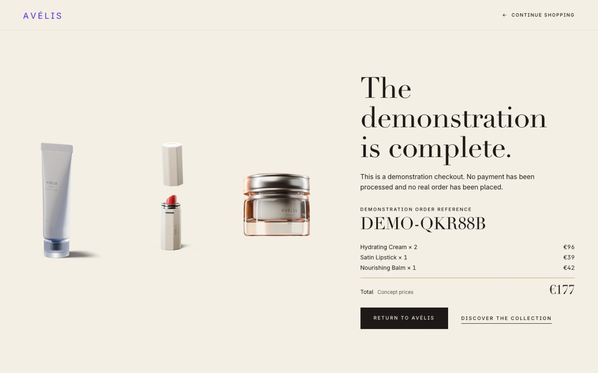

# AVÉLIS

**A fictional luxury beauty brand: original 3D product design, CGI, motion and a functional concept store.**

AVÉLIS is an independent concept project by Efim Korolev. It brings together product design, 3D visualisation, CGI, motion and digital experience, from the first product concept to the final digital presentation.

> AVÉLIS is a fictional concept brand. Prices and checkout are for demonstration purposes only. Nothing can be bought, no payment is processed and no real order is placed.



## The experience

- **Homepage:** a cinematic hero film and three editorial product compositions.
- **Product pages:** Hydrating Cream, Satin Lipstick and Nourishing Balm, each with its own composition, details and design notes.
- **Shopping bag:** a slide-out panel with quantities, Undo and a total. It stays saved in the browser between pages.
- **Demonstration checkout:** bag review, contact, shipping, order summary and a confirmation with a local demo reference.

| Product page | Shopping bag | Confirmation |
|---|---|---|
|  |  |  |

## Disciplines

3D Product Design · CGI & Rendering · Motion Design · Art Direction · Web Design & Development

The products, CGI stills and film were created in Blender. The website is hand-written HTML, CSS and JavaScript.

## How it is built

The site is entirely static. There is no backend, database, authentication, API, payment provider, framework, package or build step.

Details typed into the demonstration checkout stay in the page's memory only. They are never saved or sent.

```
index.html            Homepage
checkout.html         Demonstration checkout
products/             The three product pages
css/style.css         All styles
js/store.js           Catalogue and bag data
js/bag.js             Shopping bag panel and add-to-bag controls
js/checkout.js        Checkout steps and validation
js/main.js            Film controls, header, menu, transitions, reveals
assets/cgi/           Transparent product renders (WebP)
assets/video/         Hero film: full version and a lighter phone version
assets/images/        Film posters
assets/logo/          Wordmark and favicon (SVG)
assets/fonts/         Inter and its licence
docs/screenshots/     Images for this README
```

## Run it locally

Because the site is static, any local web server works. For example, from this folder:

```bash
python3 -m http.server 8000
```

Then open `http://localhost:8000`. Some simple servers, including this one, don't support the video range requests that Safari needs, so use another browser for local viewing if the film doesn't play.

## Hosting

All paths are relative, so the site works at a domain root or in a subfolder, including GitHub Pages project sites. Publish the repository's root folder. No configuration is needed; `.nojekyll` is included.

The full film is 77.8 MB. That is within GitHub's 100 MB per-file limit, although GitHub warns about files over 50 MB when pushing. Git LFS should not be used for it, because GitHub Pages doesn't serve LFS files.

## Browser support

Tested in Chrome 156, at widths from 280 to 3840 px, with phone and tablet sizes emulated. Not yet tested in Safari, iOS, Firefox or Android, or on real phones.

The display typeface is Didot where available, which means Apple devices. Other systems use the next available serif from the stack in `css/style.css`.

## Credits and rights

**Concept & Creative Direction — Efim Korolev**

© Efim Korolev. All rights reserved. The AVÉLIS brand, products, renders, film and code may not be reused without permission.

[Inter](assets/fonts/Inter-OFL-1.1.txt) is used under the SIL Open Font License 1.1.
